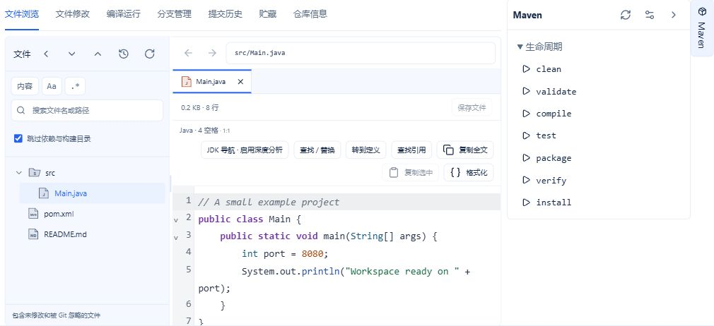

# Git Project Manager

[简体中文](README.md) · [Operations guide (Chinese)](RUNNING.md) · [Performance and disk footprint](docs/PERFORMANCE.md) · [Video tour](docs/media/gitpm-intro.mp4)

Git Project Manager is a local workspace for managing Git repositories, editing source files, and running project tasks. It runs in a browser or as an Electron desktop app for Windows and macOS. Created by 文可颂.

[](docs/media/gitpm-intro.mp4)

The 24-second tour uses a sample repository and includes Chinese and English captions.

## Install and run

| Platform | Installer |
| --- | --- |
| Windows x64 | `GitProjectManager-<version>-win-x64.exe` |
| macOS Intel | `GitProjectManager-<version>-mac-x64.dmg` |
| macOS Apple Silicon | `GitProjectManager-<version>-mac-arm64.dmg` |

Choose the installer for your architecture from [GitHub Releases](https://github.com/wenkesong-li/git-project-manager/releases). Download availability varies by version. Install Git separately. For project tasks, install the JDK, Maven, or Node.js version your project requires.

To run from source, install Node.js 24 LTS and Git, then run:

```sh
npm ci
npm start
```

Open `http://127.0.0.1:7456`. For build, backup, and publishing instructions, see the [operations guide](RUNNING.md).

## Features

| Area | What you can do |
| --- | --- |
| Repositories | Configure GitHub, GitLab, Gitee, Codeup, or a generic Git remote. Browse and clone repositories, import local checkouts, and filter or operate on several projects at once. |
| Git | Review staged and unstaged changes, inspect diffs, stage and unstage, commit, pull and push, and browse branches and commit history. |
| Stashes | Stash tracked edits and untracked files when changes exist. Search history by description, branch, or index. Expand an entry for the file list and apply, pop, or drop it. |
| File navigation | Resize or collapse the tree, expand folders, and navigate with the arrow keys. Search names, paths, or contents with optional regular expressions. Copy paths or reveal entries in the system file manager. |
| File recovery | Review application file-operation history and restore deleted items from its trash. Existing destination files are preserved. |
| Editor | CodeMirror 6 supports tabs, unsaved drafts, search and replace, multiple cursors, folding, formatting, and navigation history. JS/TS provide semantic completion, definitions, and references. Java navigation is available with a local JDK and optional JDT analysis. |
| Build and run | Discover and select JDK, Maven, and Node.js installations globally or per project. Run Maven goals from the tool window or select a supported Node.js script. Resize, copy, or stop output from the run panel. |
| Appearance | Select a workbench theme and an independent editor palette. Customize syntax colors or import supported OpenIDEA, VS Code, and IntelliJ color schemes. Preview, crop, and rotate a local background before applying it to the sidebar, workspace including code lines, or both. |
| Keybindings | Record shortcuts, assign alternatives, check conflicts, and import IntelliJ settings or keymap XML. Export and reimport GitPM keymaps as JSON. |
| Migration | Import previous local configuration, export backups with optional credential encryption, and check for desktop updates. |

Maven projects with the Spring Boot or exec plugin can use Quick Run. Node.js projects can expose `dev`, `start`, or `serve` scripts.

## Data and performance

The browser server listens on the local loopback interface. Desktop settings and encrypted host credentials are stored in the application's local data directory, with the encryption key held separately from the database. Configuration exports exclude credentials by default. Review repositories and build scripts before running them.

GitPM 2.0.0 took a median of 508 ms to load on the test Windows machine, and its installer occupied 128.36 MiB. The [benchmark report](docs/PERFORMANCE.md) includes the earlier baselines, raw samples, and test conditions.

## License and credits

Original project code is distributed under the [MIT License](LICENSE). Bundled third-party components retain their respective licenses. See [third-party notices](third-party/) and the [disclaimer](DISCLAIMER.md). The project is independent of the Git hosting providers and JetBrains products named above.
