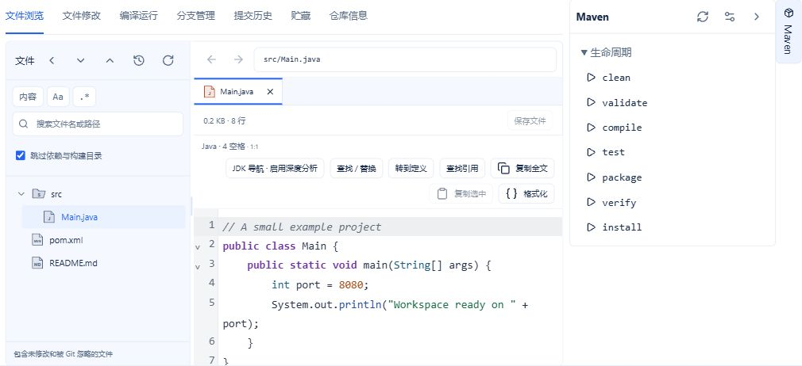

# Git 项目管家

[English](README.en.md) · [运行文档](RUNNING.md) · [性能与体积](docs/PERFORMANCE.md) · [功能演示（MP4）](docs/media/gitpm-intro.mp4)

作者：**文可颂**

面向本地开发的 Git 项目管理与代码工作台，提供 React 网页端以及 Windows、macOS 桌面端。

[](docs/media/gitpm-intro.mp4)

演示视频为 24 秒，使用独立演示仓库录制画面，附中英双语字幕。

## 下载与运行

在 [GitHub Releases](https://github.com/wenkesong-li/git-project-manager/releases/latest) 页面选择安装包：

| 系统 | 安装包 |
| --- | --- |
| Windows x64 | `GitProjectManager-版本-win-x64.exe` |
| macOS Intel | `GitProjectManager-版本-mac-x64.dmg` |
| macOS Apple Silicon | `GitProjectManager-版本-mac-arm64.dmg` |

macOS 的 ZIP 包供自动更新和便携分发使用。桌面端自带应用运行时，仍需在本机安装 Git；项目编译、运行需安装相应的 JDK、Maven 或 Node.js。没有配置开发者证书时，安装包不包含系统签名或 Apple 公证，不应通过关闭系统安全保护来安装来源不明的软件。

从源码运行建议使用 **Node.js 24 LTS、npm 和 Git**：

```sh
npm ci
npm start
```

打开 `http://127.0.0.1:7456`。Windows 也可运行 `start.bat`，macOS / Linux 可运行 `bash start.sh`。首次运行需要联网安装依赖；前端构建完成后通过本地服务加载资源。

详细环境配置、编译运行、数据迁移和发布步骤见 [运行文档](RUNNING.md)。

## 功能

| 模块 | 操作 |
| --- | --- |
| 项目管理 | 配置 GitHub、GitLab、Gitee、Codeup 或通用 Git 平台，浏览与克隆项目，导入本地仓库，按名称、路径或分支筛选，批量拉取、推送和迁移。 |
| Git 工作流 | 查看已暂存、未暂存及未跟踪文件，查看差异，暂存、取消暂存、提交、拉取、推送，管理分支和提交历史。 |
| 贮藏 | 有修改时创建贮藏，包含未跟踪文件。历史支持按说明、分支或序号搜索，展开查看文件列表，再选择应用、弹出或删除。 |
| 文件树 | 按层展开或一键折叠，左右拖动宽度，方向键导航。按文件名和路径搜索，可切换内容搜索与正则。右键复制名称、相对或绝对路径，并在文件管理器中定位。 |
| 文件保护 | 删除进入应用回收站，提供文件操作记录。恢复时保留同名现有文件。 |
| CodeMirror 编辑 | 多标签编辑、草稿保护、查找替换、多光标、括号匹配、代码折叠、格式化、复制和跳转历史。JS/TS 支持语义补全、定义和引用，Java 可使用 JDK 导航或启用 JDT 深度分析。 |
| 本地运行 | 自动发现 JDK、Maven、Node.js，多版本按项目配置。Maven 生命周期可在右侧执行。底部实时显示日志，可停止、复制以及拖动日志高度。 |
| 外观 | 界面主题与代码配色分别设置。代码内置浅色、深色和灰度，支持颜色微调、主题 JSON 与 IDEA `.icls` 导入。背景图可预览、裁剪和旋转，支持左侧导航、中间工作区（含代码行）或两边同时显示。 |
| 快捷键 | 录制组合键、配置多个绑定、检查冲突。支持 IDEA `settings.zip` 或快捷键 XML 导入，并支持应用 JSON 导入导出。 |
| 迁移与更新 | 首次启动可导入历史数据，支持配置导入导出和加密备份。桌面端可检查 GitHub Releases 软件更新。 |

快捷启动支持 Maven Spring Boot / exec 插件，以及 Node.js 项目的 `dev`、`start`、`serve` 脚本；普通 Maven 项目仍可编译，或在运行配置中选择任务。

## 性能与磁盘占用

在同一台 Windows 主机上测量 1.1.6、1.1.7 和 2.0.0。2.0.0 的启动中位数为 508 ms，安装包为 128.36 MiB。测量命令、样本及对比边界见[性能与体积](docs/PERFORMANCE.md)。

## 数据与安全

网页端默认将配置保存到用户主目录下的 `.gitpm`，桌面端使用系统应用数据目录。以 **设置 → 数据与备份 → 本机数据** 显示的路径为准。

平台令牌加密存入本机数据库，密钥独立保存在本机；认证时会将必要凭据发送至用户配置的 Git 服务。请仅连接可信平台。备份默认不含登录凭据；包含凭据时必须使用密码加密。仓库文件不包含在配置备份中。

本地服务只监听 `127.0.0.1`，不提供面向公网的访问控制。请勿将端口代理到公网或开放给不可信用户。项目脚本、Maven 插件和构建过程可执行本机命令，仅运行可信项目。应用会尝试脱敏 Git 日志，但项目自身的启动日志仍可能打印敏感内容，分享前需自行检查。

请勿提交 `.env`、数据库、`secret.key`、配置备份、证书、私钥、用户缓存和本地构建产物。提交前运行：

```sh
npm run check:secrets
npm test
```

## 技术与许可

前端基于 React、Radix 原语、CodeMirror 6、Lucide 和经适配的 React Bits 公共组件；后端使用 Node.js、SQLite 和系统 Git；桌面端使用 Electron。

本项目原创代码采用 [MIT 许可证](LICENSE)。**第三方代码分别遵守其原许可证，不因本项目采用 MIT 而变更授权。** React Bits 附带 Commons Clause 限制，GSAP 使用其 Standard No Charge License，因此不能将所有依赖笼统声明为 MIT 或无条件开源。React Bits 仅作为应用内部组件使用，不作为组件库、模板包或独立工具再分发。

第三方原文和来源见 [third-party](third-party/)；构建会生成完整的 `public/assets/THIRD-PARTY-NOTICES.txt`，可在应用“关于我们”中查看。

使用前请阅读 [免责声明](DISCLAIMER.md)。本项目不隶属于或代表 GitHub、GitLab、Gitee、阿里云、JetBrains 或其他第三方厂商。
